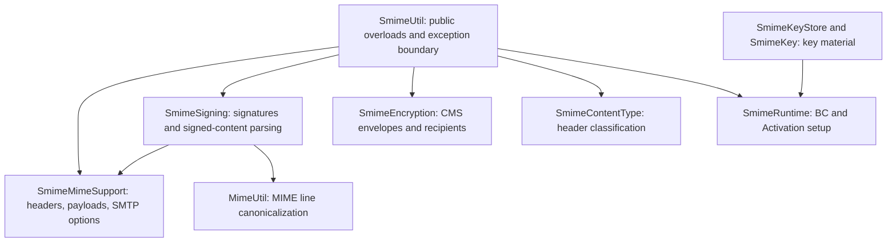

# S/MIME maintenance review — 17 October 2026

Baseline: `bdfe3be` on `master`, version `2.3.12`. Work branch:
`codex/smime-maintenance`. This is a patch maintenance candidate; no release or
runtime dependency upgrade is included.

The project now has a substantial compatibility suite and smaller internal
components behind the existing API. Existing application calls remain valid.
The next substantial improvements involve cryptographic policy, trust, parsing,
or resource limits and need an explicit compatibility decision.

## Findings addressed

| Priority | Reproduction or consequence | Change and regression evidence |
| --- | --- | --- |
| P1 | A CMS SignedData container with no signers returned `true` from signature verification. | Require at least one signer and verify every signer. `SmimeSigningTest` covers signerless, valid, tampered, missing-certificate, and mixed valid/invalid signer sets. |
| P2 | `RSA_OAEP_SHA224` mapped to the nonexistent digest `SHA-234`. | Use SHA-224. Every enum value now encrypts, serializes, parses, and decrypts a message in `SmimeEncryptionTest`. |
| P2 | Encryption overwrote repeated headers; switching to ordinary `addHeader` would reverse `Received` trace order. | Preserve repeated values and their original order with raw header lines. Tests assert both custom headers and trace headers. |
| P2 | Decryption retained the encrypted attachment's content disposition and other outer MIME metadata. | Replace Content-* headers with the decoded entity's headers and preserve its DataHandler. Tests cover charset, transfer encoding, disposition, content ID, language, and another wire round trip. |
| P2 | A newly signed body part reported a plain content type until header updates occurred; unsaved Unicode parts could lose their MIME metadata. | Prepare a MIME snapshot with updated headers before canonicalization and update the signed result's headers. Tests use body parts without `saveChanges`, Unicode, HTML alternatives, and every byte value in an attachment. |
| P2 | Signing retained the SMTPMessage subtype but discarded envelope sender, DSN, partial-send, submitter, and extension options. | Copy delivery settings while keeping MIME conversion disabled to protect signatures. Assert values and exercise actual Angus delivery against a local 8BITMIME fixture. Encryption still returns MimeMessage as its existing API promises. |
| P2 | Standard `application/pkcs7-mime; smime-type=signed-data` was classified as encrypted; only the legacy x- variant worked. | Recognize both variants and mixed-case metadata. Tests verify and extract real opaque signatures, as well as testing header-only classification. |
| P2 | Key-store-first use required prior manual BC registration. A preinstalled provider skipped explicit MIME handler registration; a custom CommandMap caused class initialization to fail. | Separate provider registration from Activation setup, initialize keystores directly, and retain application-owned command maps. Three fresh-JVM tests isolate these initialization paths. |
| P2 | Constructor callers could replace a SmimeKey certificate through the original array. Subject email extraction depended on an `E=` string format that X500Principal does not supply. | Copy certificate arrays, parse encoded subject attributes, and safely publish the immutable address cache. Tests cover both array directions, escaped names, multiple addresses, and legacy subclass overrides. |
| P2 | Signing reconstructed an issuer name from its display string, changing the encoded RDN order in the encryption-key-preference attribute. | Use the certificate's encoded issuer. The regression compares the actual DER bytes and serial number in the signed attribute. |
| P2 | The published Automatic-Module-Name contained hyphens and prevented module-path use. | Declare `org.simplejavamail.utils.mail.smime`. Classpath behavior and public Java signatures are unchanged. |
| Maintenance | Only five happy-path tests existed; inherited coverage and static-analysis tools did not support the Java 21 build. | Add real cryptographic fixtures, MIME round trips, negative cases, initialization isolation, modern build tools that still run on Java 8, and a coverage gate. |
| Documentation | The front page contained obsolete three-argument overloads, old project coordinates, unresolved reference links, and browser certificate-enrollment instructions. | Replace these with compilable examples, current coordinates, explicit ownership and trust guidance, algorithm choices, and build instructions; retain attribution and release history. |

The opaque-signature correction follows the signed-data media type described in
[RFC 8551, section 3.5.2](https://www.rfc-editor.org/rfc/rfc8551.html#section-3.5.2).

## Internal structure and ownership

All new implementation classes are package-private. Keeping them in the existing
package avoids adding public implementation types or moving existing classes.



The facade chooses the message wrapper, orchestrates the operation, and preserves
the existing SmimeException boundary. MIME adaptation owns envelope and payload
headers without choosing cryptographic algorithms. Signing and encryption own
their Bouncy Castle generators, parsers, and verification/decryption steps.
Classification reads metadata only and does not call cryptographic processing.

Generators and cryptographic operation state are created per call. No keys or
sessions are cached globally. Provider and Activation registration are JVM-wide;
existing providers and custom CommandMaps remain application-owned. The caller
owns the mail Session, delivery, input streams, certificate selection, and trust
policy. Keystore loading clears passwords in a finally block and assigns the
instance's store only after successful loading.

Static analysis has two narrow, documented suppressions: the returned address
list is already unmodifiable, and retaining public keystore subclassing prevents
making that class final merely to avoid a constructor warning. The latter is
paired with loading before instance assignment. No broad analysis exclusions or
disabled build gates were added.

## Compatibility and intentional bug-fix behavior

- The original public `javap -public` surface is unchanged: class inheritance,
  constructors, methods, fields, and enum values match the baseline.
- Java 8 source and bytecode remain the baseline. Runtime dependency versions
  remain BC 1.78.1, Jakarta Mail API 2.1.3, and Angus Mail 2.0.3.
- Defaults remain SHA256withRSA, RSA PKCS#1 v1.5 key transport, and 3DES content
  encryption. The existing advertised S/MIME capabilities are retained.
- Rejecting signerless CMS and reporting standard opaque signatures correctly
  are observable fixes. Applications accepting unsigned containers as verified
  or relying on the old misclassification should correct that assumption.
- `getSignedByAddress` retains its historical first-signer common-name result;
  it does not become an email identity or trust check. Associated key addresses
  still come from subject DN attributes, not subject alternative names.
- Malformed input can throw SmimeException rather than return false. Extracting
  signed content continues to be separate from verifying it.
- Signing retains the documented MimeMessage/SMTPMessage families. The generic
  return type does not reconstruct arbitrary application-specific subclasses;
  supporting those needs an explicit factory or adapter contract.
- Generic PKCS7 containers with absent or unfamiliar smime-type values retain
  the historical ENCRYPTED fallback. A multipart wrapper is not automatically
  searched for a decryptable child; malformed/unsupported inputs still fail.
- The JPMS metadata fix replaces a name that Java could not use as a module.
  Ordinary classpath consumers do not need configuration changes.

## Verification

The original five tests passed before changes. New tests then reproduced the
defects above before the fixes. The suite uses real Bouncy Castle operations,
runtime-generated certificate chains, an existing OpenSSL-generated PKCS12
fixture, MIME serialization/parsing, negative controls, and fresh JVMs. It avoids
global mail-session properties, DNS lookups, and external mail servers. The SMTP
integration test uses a bounded loopback fixture and verifies both the safe
default and the invalid-signature control with session-level conversion enabled.

The build uses:

```shell
mvn clean verify -Pcoverage -Dmaven.javadoc.skip=true -Dlicense.skip=true
```

| Check | Result |
| --- | --- |
| Full clean verification on JDK 8u152 | 88 tests passed; coverage gate and SpotBugs passed |
| Full clean verification on JDK 21 | 88 tests passed; coverage gate and SpotBugs passed |
| Line coverage | 398/420, 94.76% |
| Branch coverage | 144/150, 96.00% |
| Method coverage | 98/98, 100% |
| Public API comparison | Packaged `javap -public` output matches the baseline |
| Packaged bytecode format | All 16 classes use major version 52 (Java 8); no test classes or offline JaCoCo instrumentation |
| README examples | All three Java examples compiled by the test suite on both JDKs |
| JPMS artifact check | Java 21 consumer compiled and ran using the packaged Java 8 JAR and runtime dependencies |
| CircleCI configuration | `circleci config validate .circleci/config.yml` passed |
| OSS Index removal | Inherited audit execution has phase `none`; full Java 8 verification passed without scanner execution or a skip flag |

The coverage gate requires 90% lines and 80% branches. Java 8 verification used
the Windows ROOT trust store for HTTPS; TLS verification stayed enabled. The
JPMS smoke consumer explicitly required this library, `jakarta.mail`, and
`org.bouncycastle.mail`, as documented in the README.

CircleCI is configured to run the same command on topic branches, while all four release
approvals and deployment jobs are explicitly restricted to master. The existing
[maintainer guide](../MAINTAINER_WORKFLOW.md) already documents the correct
CircleCI-owned version, tag, and publication workflow; it has been updated for
the coverage build rather than replaced with another project's guide.

These tests establish local MIME and cryptographic compatibility. They do not
constitute independent Outlook, Thunderbird, or other mail-client testing.

The transport Session's `mail.smtp.allow8bitmime` setting must remain disabled for
signed content. Angus can otherwise recursively rewrite signed MIME parts, as
shown in its [2.0.3 transport implementation](https://github.com/eclipse-ee4j/angus-mail/blob/2.0.3/providers/smtp/src/main/java/org/eclipse/angus/mail/smtp/SMTPTransport.java).
The library does not mutate transport Sessions to impose policy on other sends.

## Deliberate stopping point

The next work should be separately designed and reviewed in this order:

1. **Dependency security and compatibility.** Review a coordinated Bouncy Castle
   upgrade and the current Jakarta/Angus dependency graph. Vulnerability scanning
   is intentionally outside Maven: the inherited OSS Index audit is unbound from
   the lifecycle at the maintainer's request, so builds and releases need no OSS
   Index credentials. No clean vulnerability scan is claimed by this review.
   BC 1.78.1 is an old baseline and the vendor publishes later security
   advisories. For example, [CVE-2025-8916](https://github.com/bcgit/bc-java/wiki/CVE%E2%80%902025%E2%80%908916)
   concerns PKIXCertPathReviewer, which this library does not invoke; this is
   not a blanket finding about every provider operation. Inventory the exact
   advisories and reachable operations before selecting a replacement version.
2. **Cryptographic defaults and capabilities.** Moving from legacy 3DES/RSA key
   transport or changing advertised capabilities affects recipient negotiation
   and interoperability. Make the policy and migration explicit.
3. **Trust and identity.** Trusted roots, revocation, certificate usage, sender
   address matching, SAN interpretation, and multiple-signer display policies
   require an application-facing contract. Adding mandatory validation would
   reject messages accepted by existing applications.
4. **Container policy and limits.** Recursive extraction, ambiguous multipart
   selection, unknown smime-type handling, size limits, and streaming processing
   affect accepted inputs, memory behavior, or error contracts. Multi-recipient
   encryption and authenticated-envelope APIs also belong to a feature pass.

No additional public abstractions or default policy changes were introduced to
solve these larger questions implicitly.
